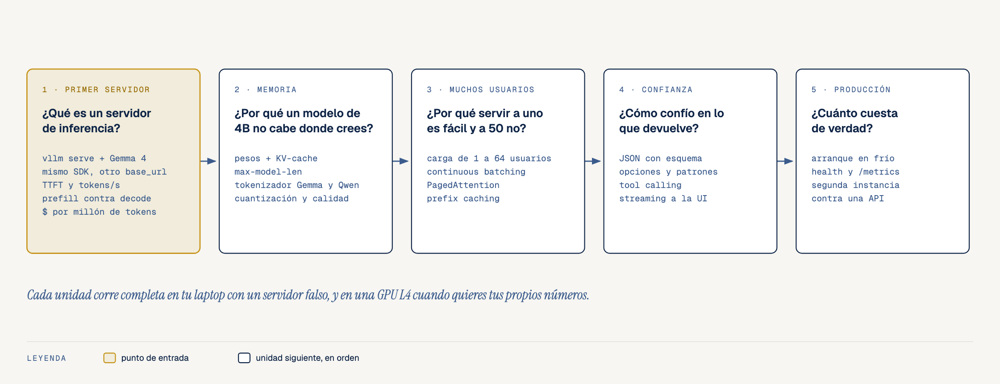
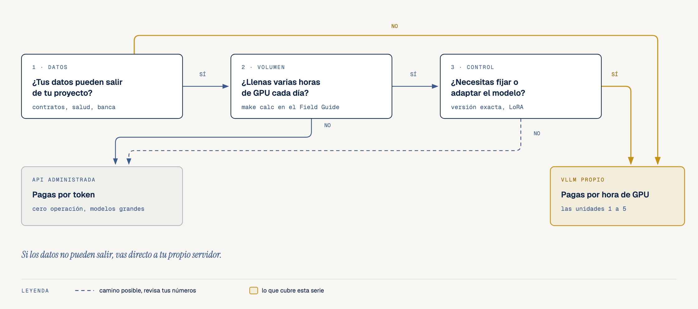
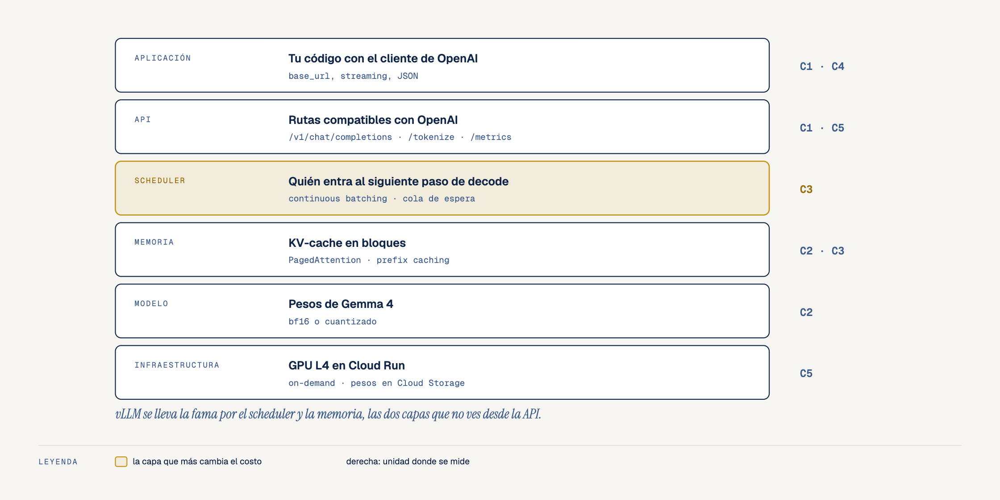

# Field Guide: Servir Modelos Abiertos con vLLM, para Software Devs

- **Por qué es relevante:** Tarde o temprano una aplicación con IA se topa con una de estas preguntas. ¿Mis datos pueden salir de mi proyecto? ¿Qué pasa con la factura si el volumen crece diez veces? ¿Puedo fijar exactamente qué modelo corre? Cuando alguna se vuelve seria, la siguiente es servir el modelo uno mismo. Esta serie responde esa pregunta con números medidos en una GPU real.
- **Para quién es:** Desarrolladores que saben Python y ya llamaron una API de IA, pero nunca levantaron un modelo propio. No necesitas machine learning, ni JAX, ni PyTorch. Si sabes qué es una petición HTTP y has visto un JSON, tienes lo necesario.
- **Qué usamos:** [vLLM](https://github.com/vllm-project/vllm) `0.33.0` (servidor de inferencia de software libre, con la misma API que OpenAI), [Gemma 4](https://huggingface.co/google/gemma-4-E4B-it) de Google (licencia Apache 2.0) y Cloud Run con una GPU NVIDIA L4 on-demand, que se apaga sola cuando nadie la usa.
- **Otros Field Guides:** si quieres entender cómo aprende un modelo por dentro, empieza por el [Field Guide de Software Dev a ML y Foundational Models con JAX](https://github.com/ykro/jax-ml-for-software-devs-field-guide). Si ya entrenas con PyTorch, el [Field Guide de PyTorch a JAX y OpenXLA](https://github.com/ykro/jax-openxla-field-guide). El orden recomendado es primero el de JAX y ML, después este y al final el de PyTorch a JAX. Este también se puede tomar solo.

---

## El mapa de la serie

### 1. Cinco preguntas, en el orden en que te las vas a hacer



### 2. ¿API o servidor propio?

La API cobra por token. Tu servidor cobra por hora de GPU, escriba un token o un millón. La pregunta que decide casi siempre es cuántos tokens le sacas a cada hora.



### 3. Lo que hay entre tu código y la GPU



---

## Los repositorios

Cada repositorio trae **5 experimentos** que corres por separado, un **juez** (`verify_*.py`) que los corre todos y revisa que se cumpla lo esperado, tests con `pytest`, 3 diagramas y los scripts de `gcp/` para levantar y apagar el servidor en tu propio proyecto (`GCP_PROJECT_ID`). También traen un **servidor falso** que imita a vLLM: `make all` corre lint, tests y el juez en tu laptop, sin GPU y sin pagar nada. Cuando quieres tus propios números levantas el servidor real y corres `make verify-live`.

| # | Repositorio | Pregunta | Qué mide |
|---|---|---|---|
| **1** | [first-vllm-server-with-gemma](https://github.com/ykro/first-vllm-server-with-gemma) | ¿Qué es un servidor de inferencia? | vLLM con Gemma 4 en una L4, HTTP puro y cliente de OpenAI cambiando solo el `base_url`, tiempo al primer token (TTFT) y tokens/s, prefill contra decode, costo por millón de tokens con 1 y con 8 usuarios. |
| **2** | Próximamente | ¿Por qué un modelo de 4B no cabe donde uno cree? | Pesos contra KV-cache, `max-model-len`, tokenizadores de Gemma y Qwen, cuantización contra calidad. |
| **3** | Próximamente | ¿Por qué servir a uno es fácil y a 50 no? | Prueba de carga de 1 a 64 usuarios, continuous batching, PagedAttention, prefix caching. |
| **4** | Próximamente | ¿Cómo confío en lo que devuelve? | JSON con esquema, opciones y patrones, tool calling, streaming a la UI. |
| **5** | Próximamente | ¿Cuánto cuesta de verdad? | Arranque en frío, health checks, `/metrics`, segunda instancia, comparación contra una API. |

**Lo que mide la primera unidad, en una línea.** En una L4 con Gemma 4 E4B, el primer token llega en **0.29 s** (casi todo es red), la respuesta sale a **25.5 tokens/s** por usuario, leer el prompt es unas **181 veces** más rápido que escribir, y el millón de tokens de salida cuesta **USD 15.60** con un usuario a la vez y **USD 2.06** con ocho. Detalle y salida del juez en el [README de first-vllm-server-with-gemma](https://github.com/ykro/first-vllm-server-with-gemma#resultados-reales-verify_first_serverpy).

---

## Calculadora, ¿API o servidor propio?

`scripts/self_host_or_api.py` compara el costo mensual de una API administrada contra tu propio vLLM, con el throughput medido en `first-vllm-server-with-gemma` y precios de lista con fecha y fuente (`benchmarks/*.json`).

```bash
make calc OUT=2000000 IN=20000000 HOURS=8
```

```text
Volume  : 20,000,000 input + 2,000,000 output tokens/day, 8 busy hours/day, 30 days
API     : gemini-3.8-flash (Standard, Gemini Developer API), checked 2026-11-10
  intro_until_2026_12_31           $675 / month
  from_2027_01_01                $1,350 / month
vLLM    : Cloud Run, 1 NVIDIA L4 (sin redundancia zonal), 8 vCPU, 32 GiB, instance-based billing, $1.4209/h
  1 user(s) at a time: 22.0 GPU h/day -> on-demand $936 / month, always-on $1,023 / month
  8 user(s) at a time: 2.9 GPU h/day -> on-demand $341 / month, always-on $1,023 / month
```

**Cómo leerla.** La API de referencia es `gemini-3.8-flash`, que es un modelo más capaz que Gemma 4 E4B. La comparación ordena la decisión por costo; la calidad que necesitas la decides con tus propias pruebas. El escenario de un usuario a la vez es el pesimista y el de ocho a la vez el optimista. Con tráfico real estás entre los dos, y la tercera unidad mide la curva completa.

---

## Cómo recorrer la serie

```bash
git clone https://github.com/ykro/vllm-for-software-devs-field-guide.git
git clone https://github.com/ykro/first-vllm-server-with-gemma.git
cd vllm-for-software-devs-field-guide
make verify   # revisa los repos de la serie que tengas clonados al lado, sin GPU
make calc     # la calculadora con el volumen por defecto
```

Para correr la primera unidad contra una GPU real necesitas un proyecto de Google Cloud con cuota de GPU L4 en Cloud Run. Las instrucciones paso a paso están en el README de [first-vllm-server-with-gemma](https://github.com/ykro/first-vllm-server-with-gemma).

---

## Videos y artículos

- **Práctica en YouTube**: [¿API o tu propio servidor? Field Guide de vLLM, práctica](https://youtu.be/IUJkq74Yijo)
- **Artículos en Substack**:
  1. [Servir tu propio modelo, una serie para software devs](https://ykro1.substack.com/p/servir-tu-propio-modelo-con-vllm)
  2. [¿API o servidor propio?](https://ykro1.substack.com/p/api-o-servidor-propio)
